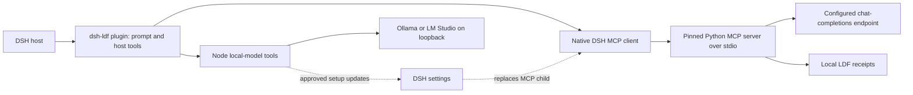
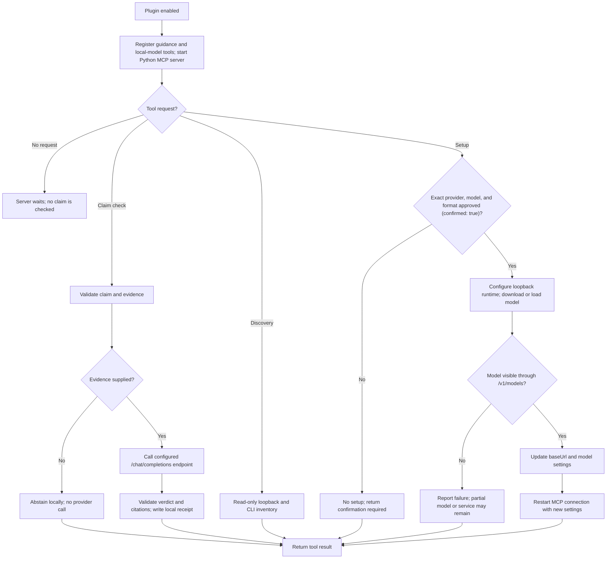

# dsh-ldf

Local Decision Framework (LDF) as a DSH host plugin. Requires DSH `>=0.2 <0.3`, Node.js `>=22`, and Python `>=3.10` with the upstream `mcp` dependency installed. This MVP was verified against the local DSH SDK at `0.2.2-alpha.2`; the declared engine range is compatibility intent, not evidence that every historical 0.2 release has the required volatile-settings API.

The upstream implementation is a Git submodule at `upstream/`, pinned by the parent repository. All DSH adaptation lives in `src/`; no upstream source files are copied or patched. The bundle patch mounts the host plugin, and `src/client.js` provides its settings form in DSH's plugin settings slot without depending on an optional host UI primitives package.

English · [简体中文](README.zh-CN.md) · [繁體中文](README.zh-TW.md)

## How it works

While enabled, the plugin registers guidance and host tools; the native DSH MCP client keeps its Python server available. Claim checks, model discovery, and model setup run only when their tools are called. Model setup proceeds only after the user approves the exact provider, model, and format. The plugin does not check claims automatically in the background.

### Architecture



### Operation flow



## Setup

```sh
git clone --recurse-submodules https://github.com/phillui-37/dsh-ldf.git dsh-ldf
cd dsh-ldf
# For an existing checkout:
git submodule update --init --recursive
python3 -m venv .venv
.venv/bin/python -m pip install ./upstream
npm install
```

Install this local directory as a bundle through DSH's plugin manager. The DSH host must provide the peer packages listed in `package.json`. In DSH Settings, open the generated **Local Decision Framework** (`ldf`) configuration form and set `python` to the absolute `.venv/bin/python` path. The plugin starts Python with the submodule's `src` on `PYTHONPATH`, so it always runs the pinned checkout rather than an unrelated globally installed LDF version.

Set `baseUrl` and `model` for an OpenAI-compatible chat-completions endpoint. The defaults target local Ollama at `http://127.0.0.1:11434/v1` with `qwen3:8b`; provision that model separately or use the model setup tool described below. LDF appends `/chat/completions` to the configured base URL. A hosted provider can use `apiKeyFile`, a path to a UTF-8 key file readable by the host; the key itself is never placed in the settings form. Configuration paths should be absolute; relative upstream paths resolve from the plugin root.

## Settings

Every field below is editable through DSH Settings and uses its native persisted profile patch. Saving settings serializes an ordinary child-fiber update, disposes the old MCP connection and prompt sections, then starts the replacement. Disabling removes the tools and guidance. A running call can be interrupted by a setting change.

| Field | Default | Meaning |
| --- | --- | --- |
| `enabled` | `true` | Enable MCP and prompt guidance |
| `python` | `python3` | Interpreter executable, preferably an absolute venv path |
| `serverName` | `ldf` | MCP namespace, 1–32 ASCII letters/digits/underscore/hyphen |
| `baseUrl` | `http://127.0.0.1:11434/v1` | Judge API base URL |
| `model` | `qwen3:8b` | Judge model |
| `apiKeyFile` | empty | Optional credential file path |
| `timeout` | `30` | Upstream HTTP timeout in seconds, 1–300 |
| `maxOutputTokens` | `1200` | Provider completion budget, 1–8192 |
| `reasoningEffort` | empty | Optional provider reasoning-effort value |
| `outputMode` | `json_object` | `json_schema`, `json_object`, or `plain` |
| `clientName` | `dsh` | Receipt caller label without whitespace |
| `capture` | `false` | Retain upstream evidence input captures |
| `captureResponse` | `false` | Retain upstream raw provider responses |
| `dataDir` | empty | Override upstream receipt/capture storage directory |
| `toolCallTimeoutMs` | `60000` | Native DSH MCP call deadline in milliseconds |
| `followUpstreamSkill` | `false` | Use the matching installed upstream skill as the plugin's only prompt guidance when available |
| `prefix` | bounded LDF usage guidance | Editable multiline model guidance |
| `suffix` | empty | Additional editable multiline model guidance |

`prefix` and `suffix` surround the plugin's own guidance region; they do not replace DSH's global persona prefix/suffix. Both are optional system-prompt contributions and work when the native `systemPrompt` service is available. The default asks the agent to check consequential uncertain claims with stable evidence IDs; it does not enforce automatic tool calls.

`followUpstreamSkill` defaults to `false`. When enabled, the plugin looks for the exact `ldf-check-claim` skill under `~/.agents/skills`, `~/.claude/skills`, `~/.codex/skills`, and `~/.opencode/skills`. A valid matching `SKILL.md` replaces all LDF plugin prompt text, including `prefix` and `suffix`; if no usable file is found, the plugin keeps the current guidance and logs a warning. This switch cannot unload a skill that DSH loaded independently.

LDF's upstream storage behavior applies: receipts are written even when capture flags are off. Configure `dataDir` and retention accordingly. Capture flags can retain evidence/provider content. The native MCP client owns process startup, reconnect, tool registration and cleanup. Startup failures are logged by DSH and can reconnect; the plugin does not pretend a missing interpreter is a successful judge call.

## Tools

The native DSH MCP client exposes upstream tools under `mcp__ldf__` by default: `ldf_check_claim`, `ldf_check_claims`, `ldf_summarize_output`, and `ldf_fetch_evidence`. A custom `serverName` changes that namespace. Their original schemas and evidence semantics come from upstream. The DSH host plugin also provides `ldf_discover_models` and `ldf_setup_local_model` while LDF is enabled. Read [upstream README](upstream/README.md) for supported evidence, verdicts, registered-source handling and provider details.

## Local model discovery and setup

`ldf_discover_models` performs an on-demand inventory of local runtimes/models and agent CLIs. It checks Ollama at `127.0.0.1:11434`, LM Studio at `127.0.0.1:1234`, and the configured `baseUrl` only when it is loopback. LM Studio's `lms ls --json --llm` inventory is queried only after its loopback API already responds, to avoid triggering app startup. Discovery does not scan ports, inspect credential files, start services, download models, or change settings. `codex` and `claude` detection only reports whether a CLI is installed; it does not inspect authentication or prove a subscription is active. OpenCode's model list is inventory only and does not make those models LDF judge backends.

`ldf_setup_local_model` supports Ollama and LM Studio. Before calling it, ask the user about RAM, available disk, language, and speed/quality needs; show the exact runtime, model identifier and format, plus an approximate download size or clearly say when it is unknown. Proceed only after the user approves that exact choice. The tool uses fixed command arguments, starts a service only on `127.0.0.1`, verifies the model through `/v1/models`, then updates LDF's `baseUrl` and `model`. It clears the configured `apiKeyFile` path when switching to local use but never deletes the referenced file. It does not install runtimes. If a later step fails, a partial model download or a running local service may remain; the result reports that state.

Ollama uses its exact model tag. LM Studio accepts `auto`, `gguf`, or `mlx`; `auto` may select the runtime's hardware-preferred variant. MLX downloads go through LM Studio. Replicate is a cloud service, not a local setup target.

## Verification

```sh
npm run check
LDF_TEST_PYTHON="$PWD/.venv/bin/python" npm test
npm pack --dry-run --json
```

The integration test composes the actual Cordis Loader, DSH system prompt, ToolRuntime, native executor and native MCP client. It launches the real upstream Python stdio server and sends a claim through DSH to a controlled loopback provider. It verifies the verdict and configured model/URL, live namespace changes, old-tool removal, edited prompt text and disable cleanup. It requires the SDK development dependencies and creates/removes its data directory inside this repository. It needs neither API keys nor an external model. A second test boots a disposable DSH profile with the real SettingsForms and ConfigEditor services to exercise form rendering, persistence, invalid-save handling and restore after restart. Neither test currently covers local model discovery/setup or upstream skill lookup.

Previous baseline validation, before the skill and local-model features were added: the integration test passed against DSH `0.2.2-alpha.2`, Node `26.13.0`, Python `3.15`, and Python MCP `1.30.0`. In a running DSH Web profile, the bundled settings form rendered and a saved prompt-suffix change remained after leaving and reopening the panel; the original empty suffix was then restored. The installed `mcp__ldf__ldf_check_claim` tool registered, but its live smoke call returned `provider_or_protocol_error` because the default local endpoint at `127.0.0.1:11434` was not listening. Real hosted-provider authentication and compatibility with other 0.2 builds remain unverified. `npm pack --dry-run` checks archive contents only. GitHub source publication does not imply publication to the npm registry.

## Licensing and submodule maintenance

DSH adaptation is MIT; see [LICENSE](LICENSE). Upstream licensing remains owned by the upstream repository; retain its license in any release. The pinned upstream checkout includes its MIT license, packaged as `upstream/LICENSE`. Maintainers should update the submodule normally, review upstream changes, and run verification again; do not vendor-copy its files into this plugin.
