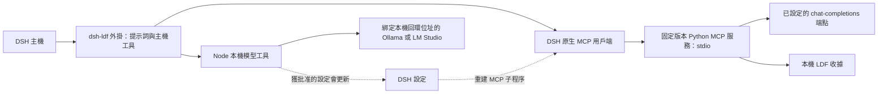
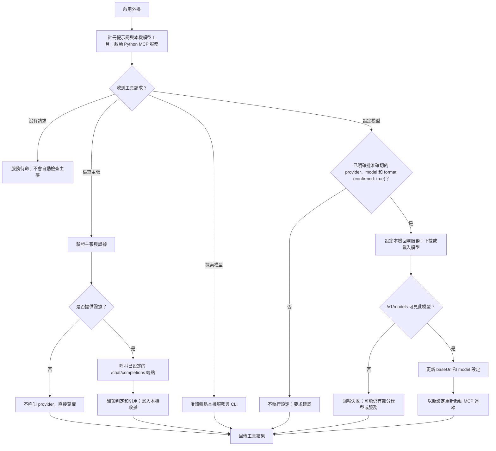

# dsh-ldf

Local Decision Framework（LDF）的 DeepSeek Harness 主機外掛。需要 DSH `>=0.2 <0.3`、Node.js `>=22`，以及安裝上游 `mcp` 相依套件的 Python `>=3.10`。此 MVP 曾使用本機 DSH SDK `0.2.2-alpha.2` 驗證；宣告的版本範圍代表相容目標，並不表示所有歷史 `0.2` 版本都具備所需的易變設定 API。

上游實作位於 Git 子模組 `upstream/`，由父儲存庫固定版本。所有 DSH 整合都在 `src/`，不會複製或修改上游原始碼。套件補丁會掛載主機外掛；`src/client.js` 在 DSH 外掛設定頁提供表單，不依賴可選的主機 UI 元件套件。

[English](README.md) · [简体中文](README.zh-CN.md) · 繁體中文

## 運作方式

外掛啟用時會註冊提示詞和主機工具；DSH 原生 MCP 用戶端會讓 Python 服務保持可用。主張檢查、模型探索和模型設定只會在呼叫對應工具時執行；模型設定必須先由使用者批准確切的 provider、model 和 format。外掛不會在背景自動檢查主張。

### 架構圖



### 操作流程



## 安裝與設定

```sh
git clone --recurse-submodules https://github.com/phillui-37/dsh-ldf.git dsh-ldf
cd dsh-ldf
# 已有複本時：
git submodule update --init --recursive
python3 -m venv .venv
.venv/bin/python -m pip install ./upstream
npm install
```

透過 DSH 外掛管理器將此本機目錄安裝為套件。DSH 主機需提供 `package.json` 中列出的 peer 套件。在 DSH Settings 開啟 **Local Decision Framework**（`ldf`）設定表單，並將 `python` 設為 `.venv/bin/python` 的絕對路徑。外掛會把子模組的 `src` 加入 `PYTHONPATH`，因此一律使用固定版本，不會改用系統中其他版本的 LDF。

設定 `baseUrl` 和 `model`，指向相容 OpenAI chat-completions 的端點。預設值為本機 Ollama：`http://127.0.0.1:11434/v1`，模型為 `qwen3:8b`；可自行準備該模型，或使用下文的模型設定工具。LDF 會在設定的基礎 URL 後附加 `/chat/completions`。託管服務可透過 `apiKeyFile` 指定主機可讀取的 UTF-8 金鑰檔案路徑；金鑰本身不會出現在設定表單中。設定路徑應使用絕對路徑；上游相對路徑以外掛根目錄為基準。

## 設定欄位

下列欄位都可在 DSH Settings 編輯，並使用 DSH 原生持久化設定。儲存後會依序更新子執行環境、關閉舊 MCP 連線和提示詞區段，再啟動新設定。停用會移除工具和指引；設定變更可以中斷執行中的呼叫。

| 欄位 | 預設值 | 說明 |
| --- | --- | --- |
| `enabled` | `true` | 啟用 MCP 和提示詞指引 |
| `python` | `python3` | Python 執行檔，建議使用虛擬環境的絕對路徑 |
| `serverName` | `ldf` | MCP 命名空間，限 1–32 個 ASCII 字母、數字、底線或連字號 |
| `baseUrl` | `http://127.0.0.1:11434/v1` | 判定 API 基礎 URL |
| `model` | `qwen3:8b` | 判定模型 |
| `apiKeyFile` | 空白 | 選用的金鑰檔案路徑 |
| `timeout` | `30` | 上游 HTTP 逾時秒數，範圍 1–300 |
| `maxOutputTokens` | `1200` | 模型回覆預算，範圍 1–8192 |
| `reasoningEffort` | 空白 | 選用的推理強度參數 |
| `outputMode` | `json_object` | `json_schema`、`json_object` 或 `plain` |
| `clientName` | `dsh` | 收據中的呼叫端標籤，不可含空白 |
| `capture` | `false` | 保留上游證據輸入擷取資料 |
| `captureResponse` | `false` | 保留上游原始模型回覆 |
| `dataDir` | 空白 | 覆寫上游收據和擷取資料的儲存目錄 |
| `toolCallTimeoutMs` | `60000` | DSH 原生 MCP 呼叫期限，單位為毫秒 |
| `followUpstreamSkill` | `false` | 找到相符技能時，只採用上游技能作為外掛提示詞指引 |
| `prefix` | 有界的 LDF 使用指引 | 可編輯的多行模型指引 |
| `suffix` | 空白 | 額外的可編輯多行模型指引 |

`prefix` 和 `suffix` 會圍繞外掛自己的指引區段，不會取代 DSH 全域 persona 的前綴或後綴。兩者都是選用的系統提示詞內容，且需主機提供原生 `systemPrompt` 服務。預設提示詞會建議 Agent 對可能影響下一步行動的重要不確定事實使用 LDF 及穩定的證據 ID；不會強制自動呼叫工具。

`followUpstreamSkill` 預設關閉。啟用後，外掛會在 `~/.agents/skills`、`~/.claude/skills`、`~/.codex/skills` 和 `~/.opencode/skills` 中尋找名稱為 `ldf-check-claim` 且 frontmatter 相符的技能。若找到有效的 `SKILL.md`，該檔案會取代 LDF 外掛提供的全部提示詞，包括 `prefix` 和 `suffix`；若找不到可用檔案，則沿用原設定並記錄警告。此開關無法卸載由 DSH 獨立載入的技能。

即使關閉擷取選項，上游仍會寫入收據。請妥善設定 `dataDir` 和保留政策；擷取選項可能保留證據或模型內容。原生 MCP 用戶端負責程序啟動、重連、工具註冊及清理。啟動失敗會由 DSH 記錄並可能重新連線；若找不到直譯器，外掛不會假裝判定成功。

## 工具

預設情況下，DSH 原生 MCP 用戶端會在 `mcp__ldf__` 命名空間提供上游工具：`ldf_check_claim`、`ldf_check_claims`、`ldf_summarize_output` 和 `ldf_fetch_evidence`。自訂 `serverName` 會變更此命名空間。工具原本的結構和證據語義來自上游。只要 LDF 已啟用，DSH 主機外掛也會提供 `ldf_discover_models` 和 `ldf_setup_local_model`。支援的證據、判定結果、註冊來源和模型端點詳情，請參閱[上游 README](upstream/README.md)。

## 本機模型探索與設定

`ldf_discover_models` 會按需盤點本機模型執行環境、模型和 Agent CLI。它會檢查 Ollama 的 `127.0.0.1:11434`、LM Studio 的 `127.0.0.1:1234`；只有目前設定的 `baseUrl` 是 loopback 時才會檢查該端點。只有 LM Studio 的 loopback API 已有回應時，才會呼叫 `lms ls --json --llm` 盤點模型，以避免觸發應用程式啟動。此工具不會掃描其他連接埠、讀取金鑰檔案、啟動服務、下載模型或變更設定。對 `codex` 和 `claude` 的偵測只會回報 CLI 是否已安裝，不會讀取認證狀態，也無法證明訂閱有效。OpenCode 模型清單僅供盤點；這些模型不會因此成為 LDF 判定後端。

`ldf_setup_local_model` 支援 Ollama 和 LM Studio。呼叫前，請先詢問使用者的 RAM、可用磁碟空間、語言及速度/品質需求；列出確切執行環境、模型 ID、格式和預估下載大小，若無法確認大小就明確說明。只有使用者同意這組確切選項後才能開始。工具使用固定命令參數，只會在 `127.0.0.1` 啟動服務，透過 `/v1/models` 驗證模型，再將 LDF 的 `baseUrl` 和 `model` 更新為本機端點。切換至本機服務時會清除 `apiKeyFile` 的設定路徑，但不會刪除該路徑指向的檔案。工具不會安裝執行環境。若後續步驟失敗，磁碟上可能留下部分模型，或本機服務仍在執行；結果會說明這些狀況。

Ollama 使用確切的模型標籤。LM Studio 支援 `auto`、`gguf` 或 `mlx`；`auto` 可能選擇執行環境偏好的模型版本。MLX 下載由 LM Studio 執行。Replicate 是雲端服務，不是本機設定目標。

## 驗證

```sh
npm run check
LDF_TEST_PYTHON="$PWD/.venv/bin/python" npm test
npm pack --dry-run --json
```

整合測試會組合真實的 Cordis Loader、DSH 系統提示詞、ToolRuntime、原生執行器和 MCP 用戶端，啟動真正的上游 Python stdio 服務，再透過受控的 loopback 服務送出判定請求。測試會驗證判定結果、模型與 URL、命名空間更新、舊工具移除、提示詞更新和停用清理；需要 SDK 開發相依套件，並會在本儲存庫內建立及清理資料目錄，不需要 API key 或外部模型。另一項測試會啟動一次性的 DSH 設定，使用真實 SettingsForms 和 ConfigEditor 服務，檢查選項顯示、儲存持久化、拒絕無效值及重新啟動後還原；後續實際 MCP 呼叫會使用已儲存的模型。以上自動測試尚未涵蓋模型探索/下載流程或上游技能查找。

先前的基線驗證使用 DSH `0.2.2-alpha.2`、Node `26.13.0`、Python `3.15` 和 Python MCP `1.30.0`。當時 DSH Web 設定表單正常顯示；修改提示詞後綴後，離開並重新開啟面板仍保留設定，接著已還原原本的空白值。`mcp__ldf__ldf_check_claim` 工具成功註冊，但當時預設端點 `127.0.0.1:11434` 未監聽，實際呼叫回傳 `provider_or_protocol_error`。託管服務認證和其他 DSH 0.2 版本仍未驗證。`npm pack --dry-run` 只檢查壓縮套件內容。GitHub 原始碼公開不代表已發布至 npm registry。

## 授權與子模組維護

DSH 整合採 MIT 授權，詳見 [LICENSE](LICENSE)。上游授權由上游儲存庫管理；發布時請保留其授權檔案。固定版本的上游目錄內含 `upstream/LICENSE`。維護者應依一般方式更新子模組、審閱上游變更並重新驗證；請勿將上游檔案複製進此外掛。
